# Database Entity-Relationship (ER) Diagram

This diagram visualizes the data model specified in Section 8 of [spec.md](file:///c:/Users/abhir/OneDrive/Desktop/AIDS/Campus%20lost%20and%20found/spec.md).

```mermaid
erDiagram
    users ||--o{ email_tokens : has
    users ||--o{ sessions : has
    users ||--o{ item_reports : reports
    users ||--o{ claims : submits
    users ||--o{ notifications : receives
    users ||--o{ audit_log : acts_in
    users ||--o{ match_feedback : gives

    campus_locations ||--o{ campus_locations : parent_of
    campus_locations ||--o{ item_reports : located_at
    campus_locations ||--o{ location_adjacency : building_a
    campus_locations ||--o{ location_adjacency : building_b

    item_reports ||--o{ item_images : contains
    item_reports ||--o{ text_embeddings : has
    item_reports ||--o{ match_candidates : "lost_side / found_side"
    item_reports ||--o{ claims : "found_item / lost_item"

    claims ||--o{ item_images : evidence_photos
    claims ||--o| handovers : issues

    match_candidates ||--o{ match_feedback : feedback_for

    users {
        uuid id PK
        string email UK
        string password_hash
        string display_name
        string role "user | moderator | admin"
        timestamp email_verified_at
        string status "active | suspended | deleted"
        string timezone
        boolean notify_match_email
        timestamp created_at
        timestamp updated_at
    }

    email_tokens {
        uuid id PK
        uuid user_id FK
        string token_hash
        string purpose "verify_email | reset_password"
        timestamp expires_at
        timestamp used_at
    }

    sessions {
        uuid id PK
        uuid user_id FK
        string token_hash
        string csrf_token_hash
        timestamp expires_at
        timestamp revoked_at
    }

    campus_locations {
        uuid id PK
        uuid parent_id FK
        string kind "campus | building | floor | room | area"
        string name
        decimal lat
        decimal lng
    }

    location_adjacency {
        uuid building_a FK
        uuid building_b FK
    }

    item_reports {
        uuid id PK
        string type "lost | found"
        string status "pending_review | open | reserved | returned | closed | removed | unclaimed_expired"
        string title
        string description
        string category
        string private_details
        jsonb verification_prompts
        timestamp window_start
        timestamp window_end
        string time_precision
        uuid location_id FK
        uuid reporter_id FK
        string disposition
        timestamp closed_at
        uuid reviewed_by FK
        timestamp created_at
        timestamp updated_at
    }

    item_images {
        uuid id PK
        string owner_type "report | claim"
        uuid owner_id
        string storage_key
        string sha256
        string dhash
        int width
        int height
        boolean is_public
        string moderation_status "pending | approved | rejected"
        timestamp deleted_at
        timestamp created_at
    }

    text_embeddings {
        uuid id PK
        uuid entity_id
        string model_name
        string model_version
        int dimension
        vector vector "pgvector(384)"
    }

    image_embeddings {
        uuid id PK
        uuid entity_id
        string model_name
        string model_version
        int dimension
        vector vector "pgvector(512)"
    }

    match_candidates {
        uuid id PK
        uuid lost_id FK
        uuid found_id FK
        decimal text_score
        decimal image_score
        decimal location_score
        decimal time_score
        decimal combined
        string bin "high | medium | low"
        string weights_version
        jsonb model_versions
        jsonb explanation
        string status "suggested | dismissed | stale"
        timestamp created_at
    }

    claims {
        uuid id PK
        uuid found_id FK
        uuid lost_id FK
        uuid claimant_id FK
        string evidence
        jsonb answers
        string status "submitted | under_review | approved | rejected | needs_more_info | completed | expired | withdrawn"
        boolean escalated
        uuid reviewer_id FK
        timestamp lock_expires_at
        string decision_note
        timestamp created_at
        timestamp updated_at
    }

    handovers {
        uuid id PK
        uuid claim_id FK
        string code_hmac
        timestamp expires_at
        int attempts
        int reissues
        string status "issued | locked | used | expired | cancelled"
        uuid completed_by FK
        string identity_note
        timestamp completed_at
        timestamp created_at
    }

    notifications {
        uuid id PK
        uuid user_id FK
        string event_type
        string event_key UK
        jsonb payload
        string status "pending | sent | failed"
        int attempts
        timestamp read_at
        string message_id
        timestamp created_at
    }

    jobs {
        uuid id PK
        string kind
        uuid entity_id
        string status "queued | running | completed | failed"
        int attempts
        timestamp run_after
        string last_error
        timestamp created_at
        timestamp updated_at
    }

    audit_log {
        uuid id PK
        uuid actor_id
        string role
        string action
        string entity_type
        uuid entity_id
        jsonb summary
        timestamp created_at
    }
```

